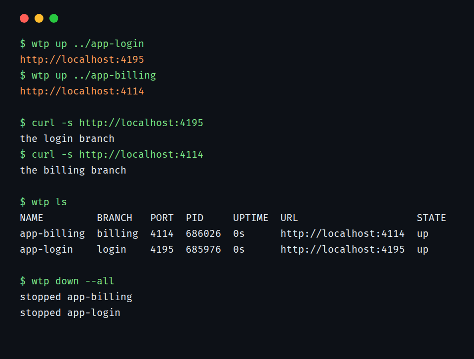

# worktree-preview

[](https://github.com/kd-011/worktree-preview/actions/workflows/ci.yml)

`wtp` starts the dev server for a git worktree on its own free port, prints the URL, and later stops exactly the processes it started.



I wrote it for running several worktrees at once, one per feature branch or one per coding agent, without port clashes, forgotten dev servers or half-dead process trees. The picture above comes from a real run: `scripts/render-demo.mjs` builds a small app, makes two worktrees, runs `wtp` and draws what it printed.

## Install

```sh
npm install -g github:kd-011/worktree-preview
```

That took about 10 seconds on a clean machine. You need Node 22 or newer and git, on Linux or macOS (Windows works under WSL). It installs from GitHub because the package is not on the npm registry yet. `wtp doctor` checks your setup.

The command is also installed as `worktree-preview`. A different tool, a Go program that manages worktree creation, is also called `wtp`. If you have both, use `worktree-preview`.

## Try it

This needs no app, only a git repository with an `index.html`:

```sh
mkdir demo && cd demo && git init -q && echo '<h1>hello</h1>' > index.html
git add . && git commit -qm init
git worktree add ../demo-b -b b

wtp up ../demo-b        # prints http://localhost:41xx
wtp ls
wtp down --all
```

With no command configured, `wtp` serves a directory that has an `index.html` with a small built-in static server.

## On a real app

```sh
git worktree add ../app-login -b login
wtp up ../app-login --install
```

`git worktree add` does not copy `node_modules`, so a fresh worktree cannot start its dev server. `--install` runs the install for whichever lockfile it finds, then runs the `dev` script with `PORT` set to a free port. The port is chosen from a hash of the worktree path, so the same worktree gets the same port each time when it is free.

I ran it from a clean directory against a Next.js app (`create-next-app`), a Vite app, and an Express app run with `node --watch`, all with npm. `wtp up` printed the URL in about 7 seconds for Next.js after the install. Vite ignores `PORT`, so when the dev script is plain `vite`, wtp adds `--port $PORT --strictPort` and says so. A dev server that wants a flag instead of an environment variable needs `--cmd 'my-server --port $PORT'`.

Run it a second time and nothing new starts: you get the same URL back. `wtp up --json` prints one JSON object for scripts, and a start that fails exits 1 with the last lines of the log.

## Commands

| Command | What it does |
| --- | --- |
| `wtp up [path]` | Start the preview for a worktree (default: the current directory) and print its URL. |
| `wtp ls` | List previews with branch, port, pid, uptime and state. |
| `wtp logs <name>` | Show the log of a preview, `-f` to follow. |
| `wtp down [name]` | Stop a preview. `--all` stops every one wtp started. |
| `wtp gc` | Remove dead entries and orphaned logs. |
| `wtp doctor` | Check git, node and the port range. |

Flags, exit codes, the config file, ports and state are in [docs/reference.md](docs/reference.md). Running it for coding agents and under systemd is in [docs/agents.md](docs/agents.md). What it promises, with the test behind each promise, and what it does not cover, is in [docs/guarantees.md](docs/guarantees.md).

`wtp up` is as trusting as `npm run dev`: it runs whatever the worktree's `package.json` or `.worktree-preview.json` says, with your permissions. Only point it at checkouts you trust.

## Other tools

I looked for what else exists before writing this section. Facts come from each project's README at the time of writing.

- Setting `PORT` by hand (`PORT=3001 npm run dev`) is enough for two worktrees. It gets tedious at five, and nothing remembers what you started.
- [wtdev](https://github.com/Dave-56/wtdev) is a single POSIX shell script that gives each worktree a stable hashed port, copies your `.env` files into new worktrees, can start servers in the background, and writes a status page. Its README says it keeps no daemon, lockfile or registry, and it lists no stop command, so stopping and cleaning up are up to you. Pick it if you want the smallest possible thing, or the `.env` copying, which `wtp` does not do.
- [worktrunk](https://github.com/max-sixty/worktrunk) is a Rust CLI that manages the worktrees themselves (create, switch, merge, hooks) and has a `hash_port` template filter for per-worktree ports. Pick it for the worktree workflow. It does not replace a process registry, and the two can be used together.
- [worktree-compose](https://github.com/mostafasudo/worktree-compose) and [dtools](https://github.com/DylanSharp/dtools) give each worktree its own ports for Docker Compose stacks. Pick those if your app runs in containers.

What `wtp` adds is a registry of what it started and a teardown that is careful: it signals the whole process group, and only after checking that the recorded pid, start time and command line still match. It never kills by process name. `wtp ls --json` and `wtp up --json` are meant for scripts and agents.

## When not to use it

- You want something to create and clean up the worktrees as well. `wtp` only serves them.
- Your app runs in containers. Use a Compose tool.
- You need real hostnames, HTTPS or a reverse proxy. Previews are `http://localhost:PORT` only.
- The server is not HTTP, or it backgrounds itself and exits. Readiness is an HTTP check, and a command that forks away looks dead.
- Windows without WSL.
- Production. Use systemd or a real supervisor.

I do not use it on macOS day to day. The macOS code path is covered by CI, not by my own use. The yarn 2+ and bun install commands have not been run against the real tools.

## Licence

MIT, copyright (c) 2026 kd-011. See `LICENSE`. Contributions: see `CONTRIBUTING.md`. Sign off your commits (DCO), there is no CLA, and add a test that fails without your change.
