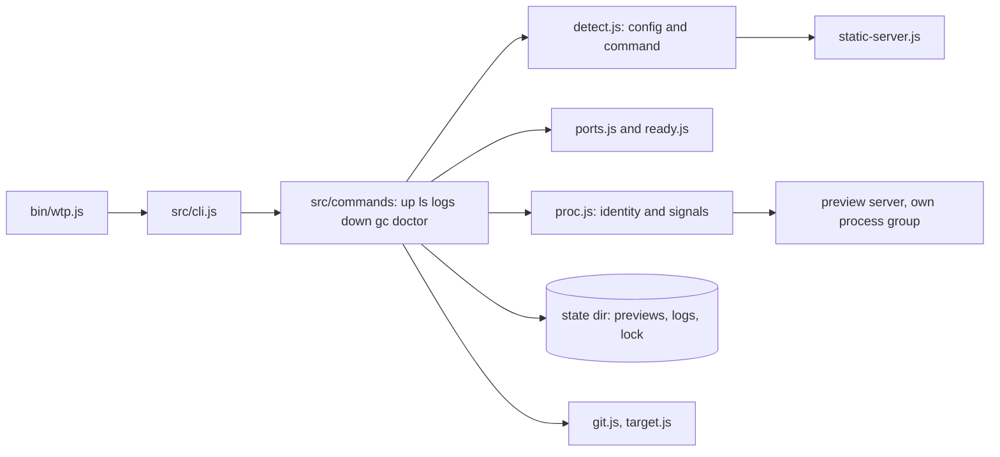

# worktree-preview: how it is built

A Node 22 command line tool with no dependencies, written as ES modules. One short-lived process per `wtp` command: it reads and writes a small registry of JSON files, and it starts, probes and signals the dev server of a git worktree. There is no daemon, so everything between commands lives in the state directory and in the processes it started. <!-- src: package.json:5, package.json:18-20, bin/wtp.js:1-9, src/state.js:1-3 -->

## Components

- `bin/wtp.js` is the entry. It runs `run(argv)` from `src/cli.js`, sets the exit code and ignores `EPIPE` so `wtp ls | head` is not an error. <!-- src: bin/wtp.js:1-9 -->
- `src/cli.js` holds the help text, the per-command flag table, strict argument parsing and the dispatch. It loads each command module on demand and maps a `WtpError` to a one-line message and an exit code. <!-- src: src/cli.js:5-44, src/cli.js:57-66, src/cli.js:88-142 -->
- `src/commands/` has one module per command: `up`, `ls`, `logs`, `down`, `gc` and `doctor`. `up.js` is the largest and owns the start, readiness and teardown logic. <!-- src: src/commands/up.js:251-335, src/cli.js:88-128 -->
- `src/detect.js` reads `.worktree-preview.json` (unknown keys are an error), picks the command to run, and chooses the install command from the lockfile. <!-- src: src/detect.js:7-8, src/detect.js:16-54, src/detect.js:79-112 -->
- `src/ports.js` parses the port range, orders candidate ports from a hash of the worktree path, and tests whether a port is free or has a listener. <!-- src: src/ports.js:5-29, src/ports.js:39-65 -->
- `src/ready.js` is one HTTP readiness probe, IPv4 loopback first and then IPv6. <!-- src: src/ready.js:8-25 -->
- `src/proc.js` reads process identity (from `/proc` on Linux and `ps` elsewhere), lists the members of a process group, and is the only place a signal is sent. <!-- src: src/proc.js:13-14, src/proc.js:22-102, src/proc.js:128-168 -->
- `src/state.js` is the on-disk registry and the lock between `wtp` processes. <!-- src: src/state.js:17-172 -->
- `src/git.js` resolves a path to its worktree root and branch by running `git`. `src/target.js` turns the `name|path` argument of `down` and `logs` into a registry entry. <!-- src: src/git.js:30-48, src/target.js:11-35 -->
- `src/install.js` runs the install command in the worktree with its output on stderr, and stops its process group when aborted. <!-- src: src/install.js:10-29 -->
- `src/static-server.js` is the built-in static file server, also runnable as a script. <!-- src: src/static-server.js:50-124 -->
- `src/errors.js` defines the `EXIT` codes and `WtpError`. <!-- src: src/errors.js:1-10 -->
- Tests are in `test/` and use `test-support/harness.js`, whose `Sandbox` gives each test file its own temp home, state directory and port block. Fixture servers are in `test-support/fixtures/`. <!-- src: test-support/harness.js:104-125, package.json:46-48 -->
- Outside the CLI: `scripts/release.mjs` plans a release for `publish.yml`, `scripts/render-demo.mjs` draws the README image, and `examples/` holds a static site, a dev server and a systemd unit. <!-- src: scripts/release.mjs:1-14, scripts/render-demo.mjs:1-4, examples/README.md:1-8 -->

## Data flow

- `wtp up` resolves the path to a worktree root with `git rev-parse --show-toplevel`, loads the config, and picks the command: `--cmd`, then `cmd` in the config, then a detected one. With none of these it exits 2. <!-- src: src/git.js:30-48, src/commands/up.js:252-253, src/commands/up.js:279, src/commands/up.js:87-93 -->
- If the worktree declares dependencies and has no `node_modules`, `up` either runs the lockfile's install first (`--install` or `"install": true`) or warns on stderr. The ready deadline restarts after an install. <!-- src: src/commands/up.js:281-293, src/detect.js:104-123 -->
- Under the registry lock, `up` checks every entry's identity, drops dead and recycled ones, and stops leftover members of orphaned groups. If this worktree already has a live preview it returns that one. Otherwise it takes the first free port and spawns `/bin/sh -c` detached in its own process group, with the output going to a log file. <!-- src: src/commands/up.js:60-131, src/commands/up.js:295-299 -->
- The new entry is written with status `starting`, then `up` polls `GET ready_path` every 100 ms until the port answers below 500, the process dies, the deadline passes or a signal arrives. <!-- src: src/commands/up.js:133-174, src/ready.js:24-25 -->
- On ready the entry becomes `up`, the child is unreferenced so `wtp` can exit, and the URL (or the JSON object) goes to stdout. On any other outcome `up` tears down what it started, removes the entry and exits with the last 20 log lines on stderr. <!-- src: src/commands/up.js:309-331, src/commands/up.js:176-194 -->
- A second `up` for the same worktree finds the live entry and waits for it to answer instead of starting another. <!-- src: src/commands/up.js:84-85, src/commands/up.js:232-249, src/commands/up.js:301-307 -->
- SIGHUP, SIGINT and SIGTERM handlers are installed before anything is spawned, so an interrupted `up` stops what it had started and exits 129, 130 or 143. <!-- src: src/commands/up.js:13, src/commands/up.js:263-276 -->
- `wtp down` resolves its target, calls `stopEntry` (identity check, SIGTERM to the whole group, SIGKILL after the grace period), removes the entry and its log, and warns if the port is still held by something outside the group. `--all` does this for every entry. <!-- src: src/commands/down.js:7-50, src/proc.js:149-168 -->
- `wtp ls` works out each entry's state (`up`, `starting`, `unhealthy` or `dead`) and removes the dead ones as it goes. `wtp gc` does the same under the lock, also removes orphaned logs and stale temp files, and with `--worktrees-gone` stops previews whose directory has gone. <!-- src: src/commands/ls.js:9-49, src/commands/gc.js:6-59 -->
- `wtp logs` reads the preview log, and `wtp doctor` checks the platform, node and git versions, the state directory and the free ports. <!-- src: src/commands/logs.js:1-53, src/commands/doctor.js:19-64 -->

## Storage

- The registry is `$XDG_STATE_HOME/worktree-preview`, else `~/.local/state/worktree-preview`. It holds `previews/<name>.json` (one entry per preview), `logs/<name>.log` (the server's stdout and stderr) and a `lock` file. <!-- src: src/state.js:11-37 -->
- Entries are written to a temp file in the same directory and renamed over the target. The directories are created `0700` and entry files `0600`, because recorded command lines can hold secrets. <!-- src: src/state.js:25-29, src/state.js:66-72, src/commands/up.js:120 -->
- An entry records `name`, `path`, `branch`, `port`, `pid`, `pgid`, `start_time`, `cmdline`, `cmd`, `started_at`, `log`, `status`, `port_env` and `ready_path`. <!-- src: src/commands/up.js:133-151 -->
- The `lock` file names its owner by pid and start time, so a lock left by a crashed process is recognised as stale and taken over. It is held while choosing a port and spawning, and during `gc`. <!-- src: src/state.js:99-132, src/state.js:134-171, src/commands/up.js:295-299, src/commands/gc.js:12 -->
- `down` removes the preview's log. A preview that died on its own keeps its log until `gc` removes it. <!-- src: src/commands/down.js:7-10, src/commands/gc.js:43-50 -->
- Nothing is written into the worktree: `.worktree-preview.json` is only read. <!-- src: src/detect.js:16-24 -->

## Auth

- There is no login and no network service of `wtp`'s own: it is a local command run with the caller's permissions. <!-- src: src/cli.js:68-129, SECURITY.md:11 -->
- `wtp up` runs whatever the worktree's `--cmd`, `.worktree-preview.json` or `package.json` names, with no confirmation, so it is only for checkouts you trust. <!-- src: src/commands/up.js:121-125, src/detect.js:79-102, README.md:63 -->
- The built-in static server binds `127.0.0.1` unless `HOST` is set, answers only GET and HEAD, and refuses `..` segments, `.git` paths and symlinks that lead outside the served tree. <!-- src: src/static-server.js:54-56, src/static-server.js:66-83, src/static-server.js:121 -->
- A signal is sent only to a process group whose leader still matches the recorded start time, command line and group, or whose leader is gone while the group still has members. `wtp` refuses to signal its own group. <!-- src: src/proc.js:115-126, src/proc.js:149-151 -->

## External services

- None are called at run time: `wtp` makes no network requests beyond HTTP probes to `localhost` ports. <!-- src: src/ready.js:8-22, SECURITY.md:11 -->
- It runs `git` (a missing binary exits 2), and on macOS `ps`. `--install` runs `npm`, `pnpm`, `yarn` or `bun`. `--open` runs the program in `BROWSER`, else `open` on macOS and `xdg-open` elsewhere. <!-- src: src/git.js:8-16, src/proc.js:41-46, src/detect.js:104-112, src/commands/up.js:209-218 -->
- Environment read: `XDG_STATE_HOME` and `HOME` (state location), `WTP_PORT_RANGE`, `WTP_TERM_GRACE_MS`, `BROWSER`, `WTP_DEBUG`, and `HOST` and `PORT` for the static server. The served command gets `PORT`, `WTP_PORT`, `WTP_NAME` and the variable named by `port_env`. <!-- src: src/state.js:11-15, src/ports.js:17-19, src/proc.js:16-20, src/commands/up.js:121, src/commands/up.js:210, src/cli.js:140, src/static-server.js:115-121 -->
- Release automation outside the CLI uses the npm registry, the `gh` CLI and the `NPM_TOKEN` secret, and the weekly upkeep job uses the lychee link checker and dossier-scribe. <!-- src: scripts/release.mjs:7-13, .github/workflows/publish.yml:59-71, .github/workflows/upkeep.yml:21-31, .github/workflows/upkeep.yml:62-63 -->

## Unverified

- The macOS code path (`ps -o lstart=` parsing, `open`) was not run here. The README says it is covered by CI and not used daily.

## Generated facts

<!-- auto:start -->
- package: worktree-preview 0.2.0
- npm scripts (1): test
<!-- auto:end -->
